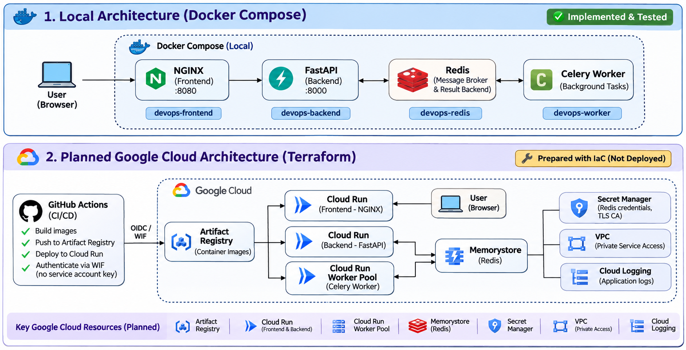

# Application Architecture

## 1. Architecture Overview



## 2. Local Architecture – Docker Compose


```text
              USER
                |
                v
         NGINX FRONTEND
         (Displays website)
                |
                v
         FASTAPI BACKEND
         (Handles requests)
                |
                v
             REDIS
         (Stores tasks)
                ^
                |
         CELERY WORKER
         (Processes tasks)

## 3. Planned Cloud Architecture – Google Cloud

                  USER
                    |
                    v
           CLOUD RUN FRONTEND
               (NGINX)
                    |
                    v
           CLOUD RUN BACKEND
               (FastAPI)
                    |
                    v
             MEMORYSTORE REDIS
            (Stores tasks/results)
                    ^
                    |
           CLOUD RUN WORKER POOL
                 (Celery)

#Supporting cloud services

GITHUB ACTIONS
      |
      v
WORKLOAD IDENTITY FEDERATION
      |
      v
ARTIFACT REGISTRY
(Stores Docker images)

SECRET MANAGER
(Stores Redis password and TLS certificate)

VPC + PRIVATE SERVICE ACCESS
(Provides private connectivity to Redis)

CLOUD LOGGING
(Collects application logs)


## 4. Cloud Resource Responsibilities

| Resource | Purpose |
|---|---|
| Cloud Run Frontend | Hosts the website |
| Cloud Run Backend | Handles API requests |
| Cloud Run Worker Pool | Processes background tasks |
| Memorystore | Stores task queues and results |
| Artifact Registry | Stores Docker images |
| VPC and Private Service Access | Provides private connectivity to Redis |
| Secret Manager | Protects Redis credentials and TLS certificate |
| GitHub Actions + WIF | Builds and deploys images securely |
| Cloud Logging | Collects application logs |

## 5. Deployment Status

- Local Docker Compose: Successfully implemented and tested.
- GitHub Actions CI: Successfully tested.
- Google Cloud authentication using WIF: Successfully tested.
- Terraform: Formatted, validated and planned.
- Google Cloud infrastructure: Not deployed.

## 6. Why Cloud Deployment Was Not Executed

The Google Cloud infrastructure was prepared using Terraform, but provisioning was intentionally deferred.

The available Google Cloud free-trial credits were limited and approaching expiration. Some planned services, especially Memorystore for Redis, have ongoing costs and no free tier.

Upgrading the billing account or using personal payment methods was not an option. To avoid unexpected charges, cloud resources were not provisioned.

The cloud deployment remains prepared for a future deployment when billing and cost eligibility can be confirmed.

